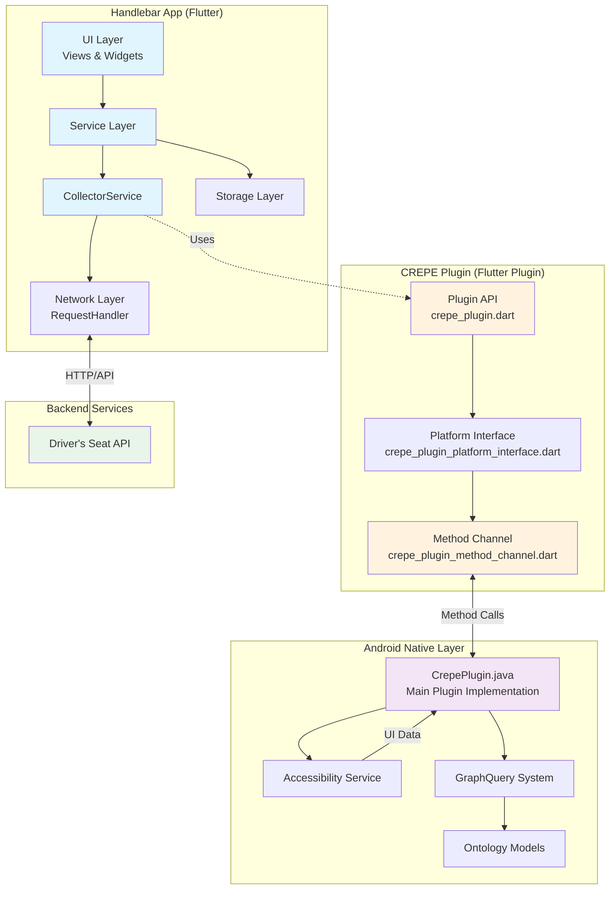

# Handlebar App + CREPE Plugin Architecture Documentation

## Project Overview

This project consists of two main components that work together to provide driver analytics and accessibility data collection capabilities:

1. **Handlebar App** (`flutter-crepe-integration/`) - A Flutter application for driver analytics that serves as the main user interface
2. **CREPE Plugin** (`crepe-flutter-plugin/`) - A Flutter plugin that provides Android accessibility services integration for UI element querying and data collection

## UI Snapshot Recording & Replay Tool

The core research functionality of this system is the UI Snapshot Recording and Replay tool, which allows researchers to capture, store, and analyze UI interactions across any Android application.

### Recording Features

#### Starting a Recording
1. **Long press** the "Handlebar" title in the app header to open the Developer Menu
2. Toggle the **"Recording Mode"** switch to start recording
3. A red "REC" indicator will appear in the app bar
4. The system captures UI snapshots at configurable intervals (default: every 1 second)

#### What Gets Recorded
- **UI Snapshots**: Complete accessibility tree of the current screen
- **Metadata**: Device info, screen dimensions, timestamps
- **Auto-save**: Recordings are automatically saved every 10 seconds during recording
- **Maximum snapshots**: Configurable limit (default: 1000 snapshots)

#### Stopping & Saving
- Toggle off "Recording Mode" in the Developer Menu
- Recordings are automatically saved and shared via the system share dialog
- Files are saved as compressed ZIP archives containing:
  - `metadata.json`: Session information (device, screen size, timestamps)
  - `snapshot_[timestamp].json`: Individual UI snapshots with accessibility data

### File Storage

Recordings get stored on-deivce:

- **App Storage**: `[ExternalStorage]/Recordings/` (app's private external storage)
- **File Format**: `handlebar_ui_snapshots_[timestamp].zip`
- **Auto-save Files**: `handlebar_autosave_[timestamp].zip` (automatically cleaned up)

#### Recording file structure
```
handlebar_ui_snapshots_1234567890.zip
├── metadata.json           # Session metadata
├── snapshot_1234567890.json  # UI snapshot at timestamp
├── snapshot_1234567891.json  # Next snapshot
└── ...                      # More snapshots
```

#### Metadata Contents
- Recording start/end time
- Device model and Android version
- Screen dimensions
- App version and build number
- Capture interval settings

### Replay Tool

#### Accessing the Replay Tool
Navigate to the **Crepe UI Snapshot Replay** screen from the app menu

#### Loading Recordings
1. Click **"Load Recording"** button or the folder icon
2. Select a `.zip` file from your device storage
3. The tool will extract and load all UI snapshots

#### Playback Controls
- **Play/Pause**: Automatically step through snapshots at 1-second intervals
- **Scrubber**: Seek to any point in the recording
- **Frame Navigation**: Jump to specific snapshot by index
- **Timestamp Display**: Shows current and total recording time
- **Snapshot Counter**: Displays current snapshot number and total

#### Visualization
The replay tool renders a primitive UI representation showing:
- UI element hierarchy
- Text content and labels
- Element boundaries and positions
- Accessibility properties

### Import/Export Workflow

#### Exporting Recordings
1. After stopping a recording, the app automatically triggers the share dialog
2. Choose where to save/share the ZIP file:
   - Save to Google Drive/Dropbox
   - Share via email/messaging apps
   - Save to device Downloads folder

#### Importing Recordings
1. Open the Replay Tool
2. Click "Load Recording"
3. Browse and select any `handlebar_ui_snapshots_*.zip` file
4. The tool supports recordings from any device/session

### Technical Implementation

The recording system consists of:
- **UiSnapshotRecordingService**: Manages recording lifecycle and snapshot capture
- **MediaStoreService**: Handles file storage and sharing
- **RecordingPreferencesService**: Manages user preferences
- **ReplayCrepeSnapshot**: Provides playback and visualization interface
- **CREPE Plugin Integration**: Captures accessibility data via Android AccessibilityService


## Repo Structure

```
dsc-app-and-plugin/
├── flutter-crepe-integration/     # Main Flutter application (Handlebar)
│   ├── lib/
│   │   ├── main.dart              # App entry point
│   │   ├── models/                # Data models
│   │   ├── services/              # Service layer (CollectorService, etc.)
│   │   ├── views/                 # UI screens
│   │   ├── widgets/               # Reusable UI components
│   │   ├── navigation/            # Routing logic
│   │   ├── network/               # API communication
│   │   └── storage/               # Local storage management
│   ├── android/                   # Android-specific app code
│   ├── ios/                       # iOS-specific app code
│   ├── crepe-flutter-plugin/      # Git submodule (symlink)
│   └── pubspec.yaml              # App dependencies
│
└── crepe-flutter-plugin/          # Flutter plugin (Git submodule)
    ├── lib/
    │   ├── crepe_plugin.dart                      # Plugin API interface
    │   ├── crepe_plugin_method_channel.dart       # Method channel implementation
    │   └── crepe_plugin_platform_interface.dart   # Platform interface definition
    ├── android/
    │   └── src/main/java/com/dsc/plugins/crepe/
    │       ├── CrepePlugin.java                   # Main plugin implementation
    │       └── graphquery/                         # Graph-based UI query system
    │           └── ontology/                       # Ontology-based query models
    └── pubspec.yaml                               # Plugin dependencies
```

## Git Submodules Setup

### How Submodules Work

Git submodules allow you to include one Git repository inside another as a subdirectory. This maintains separate version control for each component while linking them together.

### Current Configuration

The CREPE plugin is configured as a git submodule within the Handlebar app repository:

**Location**: `flutter-crepe-integration/crepe-flutter-plugin`
**Remote**: `https://github.com/Princeton-HCI/crepe-flutter-plugin.git`
**Tracking**: `main` branch

### Submodule Configuration Details

The submodule is defined in `.gitmodules`:
```gitconfig
[submodule "crepe-flutter-plugin"]
    path = crepe-flutter-plugin
    url = https://github.com/Princeton-HCI/crepe-flutter-plugin.git
```

The app's `pubspec.yaml` references the plugin using a local path:
```yaml
dependencies:
  crepe_plugin:
    path: ./crepe-flutter-plugin
```

### Working with Submodules

#### Initial Setup
```bash
# Clone the main repository with submodules
git clone --recursive [repository-url]

# OR if already cloned without submodules
git submodule init
git submodule update
```

#### Updating the Submodule
```bash
# Navigate to the app directory
cd flutter-crepe-integration

# Update submodule to latest commit on tracked branch
git submodule update --remote

# Commit the submodule pointer update
git add crepe-flutter-plugin
git commit -m "Update crepe-flutter-plugin to latest version"
```

#### Making Changes to the Plugin
1. Navigate to the plugin directory: `cd crepe-flutter-plugin`
2. Make your changes and commit them
3. Push changes to the plugin repository: `git push origin main`
4. Return to the parent repository and update the submodule reference
5. Run `flutter pub get` to ensure dependencies are updated

## System Architecture Diagram



## How App and Plugin Work Together

### 1. Communication Flow

The app and plugin communicate through Flutter's platform channels using a request-response pattern:

1. **App initiates request** → CollectorService calls plugin API methods
2. **Plugin API** → Routes through platform interface to method channel
3. **Method Channel** → Invokes native Android methods via platform channel
4. **Native Android** → Executes accessibility service operations
5. **Response flows back** → Through the same chain in reverse

### 2. Key Integration Points

#### Initialization Flow
```dart
// In CollectorService (App)
await _crepePlugin.initializeGraphQuery();
_crepePlugin.setCollectorMatchesCallback(_handleContinuousMatches);
```

#### Data Collection Flow
1. **Fetch Collectors**: App requests collector configurations from backend
2. **Update UI Snapshot**: Plugin captures current screen state via accessibility service
3. **Match Collectors**: Plugin matches collector patterns against UI elements
4. **Send Events**: App sends matched events back to backend

#### Continuous Monitoring
- Plugin monitors UI changes in real-time via accessibility service
- When matches are found, plugin invokes callback to notify app
- App processes matches and sends events to backend

### 3. Data Flow Example

```
User Action on Screen
        ↓
Android Accessibility Service (Plugin)
        ↓
UI Snapshot Captured (Plugin)
        ↓
Graph Query Matching (Plugin)
        ↓
Match Results Callback (Plugin → App)
        ↓
CollectorService Processing (App)
        ↓
API Event Submission (App → Backend)
```

### 4. Plugin Capabilities

The CREPE Plugin provides:

- **Accessibility Service Integration**: Captures UI element data from any Android app
- **Graph-based Queries**: Uses ontology-based queries to find UI elements
- **Real-time Monitoring**: Continuously monitors UI changes
- **Permission Management**: Handles accessibility permission requests
- **UI Snapshot Management**: Captures and stores current screen state

### 5. App Responsibilities

The Handlebar App handles:

- **User Interface**: Provides the main UI for users
- **Backend Communication**: Manages API calls to Driver's Seat backend
- **Data Management**: Stores and manages collector configurations
- **Event Processing**: Processes matches and sends analytics events
- **User Preferences**: Manages recording preferences and settings

## Key Components Interaction

### CollectorService (App) ↔ CrepePlugin

The `CollectorService` is the main integration point between the app and plugin:

```dart
class CollectorService {
    final CrepePlugin _crepePlugin = CrepePlugin();

    // Initialize plugin and set up monitoring
    Future<bool> initialize() async {
        await _crepePlugin.initializeGraphQuery();
        _crepePlugin.setCollectorMatchesCallback(_handleContinuousMatches);
        // ...
    }

    // Process matches from plugin
    void _handleContinuousMatches(Map<String, dynamic> eventData) {
        // Process and send to backend
    }
}
```


## Summary

This architecture provides a clean separation between:
- **Plugin**: Low-level accessibility service integration and UI querying
- **App**: High-level business logic, user interface, and backend communication

The git submodule approach allows independent development and versioning of the plugin while maintaining tight integration with the app. The method channel pattern provides a clear, type-safe communication bridge between Dart and native Android code.